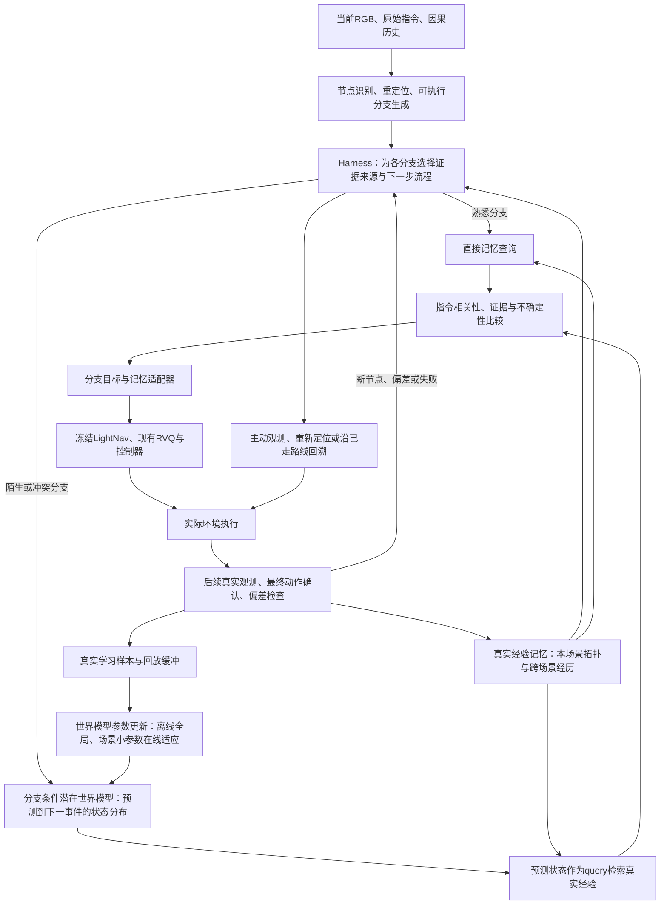

# LightNav：事件节点世界模型、双用途记忆与 Harness 协同方案

日期：2026-11-03。状态：研究架构与实施交接，尚未实现本文的新系统。本轮通过 `ssh CEC` 读取真实仓库 `/home/szgx/LightNav-0` 的源码和实验报告，并核对公开项目；没有启动 Habitat、提取特征、训练、评测或修改导航逻辑。

本文更新研究方向，不覆盖旧实验、数据或旧方案。旧文档中的“只保留当前 episode 记忆”和“单步未来特征预测”仅代表当时的阶段设计；本方案扩展到事件尺度、场景持久记忆及可隔离的参数适应。服务器现有 schema 已是 `wm-transition/0.2`，不沿用旧交接中 `0.1` / `dt_sim_s` 只能为 null 的历史结论，也不在本任务升级 schema。

## 1. 研究目标与能够承诺的边界

用户需要一条完整链路：

> 在岔路、门口、转弯等关键节点识别真实可执行分支；对陌生分支预测走过去之后可能遇到的空间状态；用预测查询真实历史经验；结合指令选择分支并交给 LightNav 执行；观测不符时主动观察或沿实际路线回到已确认节点；真实经验既更新记忆，也改善世界模型参数。

走熟之后，可靠的同场景记忆可以直接支撑决策，跳过世界模型。熟悉度按“节点 × 分支 × 当前任务相关性”判断，不能用“进入过这个 scene”代替所有分支都熟悉。

世界模型预测的是部分可观测环境中的条件分布。陌生房门后有什么、未走通道如何连接，在观测不足时不能唯一确定；应该给出多个可能状态、各自依据和不确定性，并允许“不知道”。同场景反复走过后，记忆和参数适应可以收窄这种不确定性，仍不能保证所有隐藏目标可知。

R2R 的首要任务仍是遵循指令。房间类型、地标和目标物体作为指令匹配线索；没有实际物体标注时，不声称已实现 ObjectNav。没有看到物体不等于物体不存在。

## 2. 本轮核实的真实状态

服务器：SSH 别名 `CEC`，工作目录 `/home/szgx/LightNav-0`。分支 `local/research-snapshot`，HEAD `4933c66f32898175cd5b8ce870c40d8ac26c8765`，已有大量已修改和未跟踪文件。均保留；本文只新增设计和交接文档。

| 证据位置（相对真实仓库） | 本轮读到的事实 | 对新方案的影响 |
|---|---|---|
| `src/lightnav/habitat/runner.py:561–576,642–693` | 存在 env/policy/engine 工厂；循环调用 policy.act、env.step；没有通用 post_step 回调 | 可用独立实验 policy/env wrapper；完成观测更新需明确 wrapper 回调 |
| `src/lightnav/habitat/policy.py:41–47,158–198` | RGB 历史与指令生成一条轨迹；选择首个有效航点转成速度 | 10 个航点不是 10 条路线；没有现成事件分支候选接口 |
| `src/lightnav/inference/engine.py:235,284` | 接受 raw sample 或帧序列，输出动作文本 | 不能将新潜变量直接当基座输入，也不能假设任意子目标已受支持 |
| `src/lightnav/inference/samples.py:29–68` | SlowFast 使用完整 episode 缓冲及绝对帧位置，忽略传入 frame_ids | 不得拼接跨片段图像后伪装连续视频 |
| `experiments/world_model/online_input.py:11–52` | 屏蔽 GT pose、距离、目标位置和评测指标；在线观测仅 RGB/指令 | 真值位姿、测地距离不进入 Harness/记忆查询；真实 depth 需作为显式传感器扩展单列 |
| `experiments/world_model/server_adapter.py:433–543` | 独立采集 adapter 捕获转换后的最终动作、执行状态、时间及观测 | 可复用执行证据；普通在线服务是否提供这些字段仍需专项核实 |
| `experiments/world_model/__init__.py` | schema 为 `wm-transition/0.2` | 不修改原始记录或回退 schema |
| `experiments/world_model/configs/collect_train_go2w_radius010.yaml` | radius=0.10m，相机高0.50m，RGB/depth 480×270、HFOV120°，控制命令时域0.1s、环境上限500步 | 后续配置和比较保持这些已接受条件；事件尺度不等于改控制时域 |
| `output/world_model_training/first_v1_20261029/training_report.json` | fit 1816、dev 3249；各8场景，无共享scene/route | 这些是旧单步配对样本数，不是事件分支样本数 |
| `output/world_model_training/stage_a_residual_query_film_20261102_01/report.md` | 三 seed 残差有/无动作仍在1%带内；约0.87053，零残差约0.87039 | 停止将0.1秒 SigLIP 全网格重建作为主线；不能据此否定所有表征和事件预测 |
| `output/world_model_diagnostics/stage_a_ego_warp_20261102_01/report.md` 和 `stage_a_rejected_command_20261102_01/report.md` | 几何短期画面变换有效；修正规则用了过去已测到的位姿，不是未来位姿；未接入导航 | 这是短期几何诊断，不能升级成长期语义预测，更不能把 GT 过去位姿默认为在线可用 |

以上是静态代码/报告核实，不是本轮重跑结果。没有重跑测试。8张 A800-SXM4-80GB 可见，查询时0/1号卡有占用、2–7号卡空闲；只是当时资源快照，不占用或终止任何进程。

## 3. 总体架构



只有执行器把命令交给环境；所有模块消费有可见时刻的记录。记忆检索只能访问本次决策之前已经可见的真实记录。预测假设可保存用于误差分析，但不进入“真实观察”索引或充当标签。

## 4. Harness 的职责与边界

Harness 是策略编排层，初版用可检查的状态机和规则，复杂推理可后续接 VLM 工具。它调用各模块，不自己训练一个包办一切的导航大模型。

| 职责 | 具体行为 | 不能冒充的能力 |
|---|---|---|
| 事件管理 | 调用感知模块提出门口/岔路/转弯候选，确认、合并节点，管理停留与去抖 | 感知模块误检不能被语言推理当成真节点 |
| 分支管理 | 获取可执行局部候选，管理方向、执行范围、已探索状态 | 不能从10个RVQ时序航点制造10条候选 |
| 证据路由 | 按分支选择直接记忆、预测后检索或补观测 | 访问次数和向量相似度不等于可信度 |
| 候选比较 | 结合原始指令、真实后果、预测分布及不确定性，确定局部分支目标 | 相似房间不是本场景连通事实 |
| 主动观测 | 请求有限转头/转身、移动到可观察位置，验证新证据 | 不能在线恢复 simulator 状态查看未走分支 |
| 回溯与重规划 | 沿已实际走过的边回到可信节点；边失效或定位失败则中止该计划 | 回溯不等于时间倒带；反向播放速度也不保证可返回 |
| 更新调度 | 真实结果到达后写记忆、生成学习样本，满足条件时触发小参数更新 | 不用未执行分支预测自举成真值 |
| 预算与审计 | 记录触发原因、模型/记忆版本、额外动作/算力，执行步数和时间限额 | 不能用零速表示“暂停”：当前策略的零速度可能触发STOP |

建议状态：`NORMAL`、`AT_EVENT`、`DIRECT_MEMORY`、`PREDICT_RETRIEVE`、`ACTIVE_OBSERVATION`、`COMMIT_BRANCH`、`VERIFY`、`BACKTRACK`、`SAFE_FALLBACK`。不是每一控制步都运行全部模块。

路由条件由训练开发集校准：节点定位可靠度、该分支真实覆盖、记忆是否新鲜且一致、当前指令相关性、预测校准、总预算。不能现在凭空设一个0.8阈值并称其有效。同一个节点可以左支直接记忆、右支预测；候选证据等级不同要显式展示。

## 5. 节点、分支和双用途记忆

### 5.1 事件节点和可执行分支

节点记录真实观察、多视角片段引用、局部空间/语义摘要、重定位描述子、已确认边和不确定性。门口、岔路等是类型假设，需保留感知置信度。用观测重定位与历史连续性合并节点，不能直接用 Habitat GT 坐标作为在线完美节点ID。

分支是一个有终止条件的局部技能（option）：例如“沿左侧门口穿过入口，直到下一个事件点或执行预算结束”。字段至少含起始节点、当前可观察的出口、相对方向/局部目标、技能执行策略版本、允许的控制范围和最长执行范围。`p(后果 | 当前belief, 分支, 执行策略)`必须固定执行策略，否则“走左边”的后果定义不唯一。

RGB可用于节点/出口提议；几何可行性不能只靠一个VLM结论。主线先保持现有RGB输入契约。若为分支验证增加真depth、在线估计depth/里程计，分别声明为 RGB-D 扩展或可部署估计模块，并做等传感器对照。GT位姿只用于采集/离线标签及明确标注的oracle上界。

### 5.2 三个逻辑存储，两个研究用途

| 存储 | 内容 | 用途 |
|---|---|---|
| 场景拓扑记忆 | 本场景真实节点、真实走通的边、分支后果、地标与视角 | 熟悉场景直接查询；回溯与重访 |
| 跨场景经验库 | 其他已允许场景的真实观测与行为结果，保留来源 | 陌生分支按预测状态检索相似经验；只能提供类比先验 |
| 学习回放缓冲 | 决策前输入、预测、选中分支、实际命令序列、真实事件后果、质量与可见时刻 | 离线全局训练与场景参数适应 |

实现上可共享不可变观察文件和记录ID，不复制伪造内容。真实拓扑边必须经过实际走通确认；由预测提出的边保存在假设表中，不能用于可靠回溯。

当前episode短期状态reset清空；场景记忆和场景适配参数按明确场景命名空间保留；全局经验库按协议管理。评测若直接用环境scene_id选择历史场景库，必须披露为已知场景身份条件；未知场景识别是另一项能力。不得以GT坐标替代定位。

向量特征须固定teacher版本和预处理。在线更新只改世界模型的query预测，不改索引使用的冻结encoder；否则旧key与新query不在同一空间。若更换encoder，重新建版本化索引，不能混检。

## 6. 世界模型的建议结构

### 6.1 首选：事件尺度、分支条件的随机潜在状态模型

借鉴 Memoir 的 TSSM / RSSM prior-posterior 训练与潜在状态检索，但加入真实分支条件、连续环境执行语义和事件终止建模。首个工程候选为小型 TSSM，保留确定性网络作为必要基线，不声称它一定有效。

```text
当前与近期真实RGB -> 冻结DINOv2空间特征 -> 带坐标的少量空间/区域token
原始指令        -> 冻结文本编码器     -> 指令token
真实节点/动作历史 + 可选因果记忆摘要 -> 历史Transformer -> belief h_k
候选分支描述 + bearing + 技能策略ID -> 分支编码器       -> c_k

[h_k, 当前空间token, 指令token, c_k]
          -> 条件Transformer转移prior p(z_(k+1) | h_k,c_k,instruction)
          -> 多个未来状态假设
          -> 未来事件视觉/语义检索向量、粗结构状态、事件类型/到达分布

训练或真实后果到达后：
真实下一事件多视角观察 -> 冻结teacher特征 -> posterior q(z | h_k,c_k,Y_(k+1))
          -> 监督预测并修正当前belief
```

prior是执行前预测；posterior是看到实际结果后的状态修正。训练可以用posterior看未来结果，部署时不能提前使用它；必须单独评估仅prior的预测，不能用posterior重建分数证明未见未来的预测能力。

推荐从“宽度512、6层、8头、FFN2048、最多32个当前空间token、4个历史节点、64维随机latent、每分支4个样本”起步。这些是待登记的设计值，不是论文参数或已验证最优值。预计新增可训练部分为数千万参数，必须实现后实际统计；不再用0.15M参数作为不允许改动的上限。冻结encoder与LightNav分别计数。

初版空间encoder优先预训练DINOv2 ViT-B/14；语义检索可复用本机SigLIP，但目标改为下一事件的真实多视角语义，不恢复0.1秒全网格路线。是否合并双encoder要用检索质量和成本决定。DINOv2本机可用权重尚未证实；缓存目录或refs不是完整权重证据。文本接口可复用经核实的SigLIP文本塔；长指令截断需统计，必要时换明确的预训练文本encoder。

还应保留一个无需训练新转移网络的预训练VLM基线：例如独立的Qwen3-VL-4B-Instruct，输入当前可见多视角、出口候选和真实检索证据，输出带unknown的未来语义假设。它能复用语言/视觉常识，不等于知道陌生房门后的真实布局；也不保证优于检索近邻。该基线与事件TSSM使用同一证据和评价集，以判断专门训练世界模型是否有额外价值。独立VLM可用于节点提议和弱标注，但不能默认导航微调后的LightNav还保留通用问答接口或结构化输出能力。本轮仅核实Qwen官方模型卡存在、公开且Apache-2.0，没有下载或加载它。

### 6.2 输出表达与能回答的问题

| 输出 | 表达 | 能支持的决策 |
|---|---|---|
| 未来事件检索状态 | 与冻结teacher目标同空间的向量/少量token；多假设分别检索 | “这条路后面可能像过去哪段经历” |
| 房间/事件类别 | 概率分布，含unknown；有标签才训练 | “更像走廊还是房间入口” |
| 粗布局与连通 | 可观察的出口/地标关系、局部相对方位及其概率 | “可能还有一个向右出口”；不冒充完整房间地图 |
| 目标/地标证据 | 出现概率、观察覆盖和unknown | “可能看到指令中的沙发”；不等于已确认存在 |
| 到达与风险 | 到下一事件的步数/距离分布、截尾概率；有可靠标签才训练受阻等头 | 比较探索代价；预算终止不标成成功到达 |
| 不确定性与来源 | 假设间分歧、校准结果、支持样本、模型与记忆版本 | Harness决定预测是否足以支持行动 |

首个训练版本只做“未来事件检索状态 + 事件到达/类型”，其余头按标签覆盖逐个加入。布局先使用粗关系；完整几何布局需要后续多视角建图和对应监督，不能承诺仅换网络就得到。

预测分布只能表达条件上的可能性；4个随机样本也不自动保证覆盖所有可能房间。跨seed/ensemble分歧可辅助估计模型不确定性，但仍须开发集校准。

### 6.3 指令条件的处理

世界物理后果不会因指令措辞改变。环境转移以状态和分支为主要条件；指令用于选择关注地标、相关语义投影和检索重排。若也将指令输入转移模型，需要做无指令/同义指令一致性检查，避免“指令说有厨房，就预测厨房”。结构状态与任务相关评分分开输出。

## 7. 预测如何真正查询记忆并影响 LightNav

执行前对每个候选分支生成未来状态假设，用固定空间的预测向量查询已可见的真实经历，返回真实图像、当时的分支/行为和实际后果；按指令相关性、来源、观察覆盖和可靠性重排。使用多个预测假设分别检索，保留分歧，避免平均向量检索到两边都不像的场景。

熟悉分支可直接从本场景节点边查到实际后果；它不需要再次预测才能检索。本场景经历优先用于事实判断，跨场景相似经历只能辅助推测。没有记忆命中不意味着路线错误，也不意味着目标不存在。

冻结LightNav接入必须分两条接口，不能只产出分数：

1. **MemoryInputAdapter**：将检索到的真实RGB片段作为显式、带来源和时间的视觉上下文，保留当前/近期片段和视觉token预算。跨episode片段不能伪装成当前连续视频。使用 `engine.generate(sample)` 所接受的显式segments进行独立实验，核验prompt、tubelet、cache与processor；这只是候选接入方式，当前模型能否理解仍需验证。
2. **BranchExecutionAdapter**：Harness选定分支后，向独立实验policy传递可检查的局部目标/出口约束。先验证冻结LightNav是否能通过单独的局部VLN子指令可靠跟随所选分支；保留原始全局指令和目标来源，记录实际是否进入该分支。当前没有现成结构化subgoal API，不在基座中塞任意latent，也不声称换个prompt就一定服从。

若第二项无法可靠执行，应先修局部分支执行接口；不能把“输入了一张检索图”当成完成路线选择。若增加几何局部控制器，要单列其贡献和等控制器对照，不悄悄替换LightNav后宣称世界模型提高了导航。

普通runner可用工厂函数接独立policy/env wrapper；默认关闭时必须还原现有输入、输出和行为。每帧只observe一次；不要调用两次原policy.act导致重复入历史。执行完成通知驱动真实记忆和训练样本落地，客户端proposal与最终执行ack不一致时显式标记。

## 8. 数据：复用什么、还缺什么

现有正式train数据、RGB和命令/位姿/时间日志可以构造长片段及已实际走过的事件转移；旧单步缓存可用部分不能被当成已覆盖新的事件监督。先静态审计完整轨迹和RGB保留情况、末帧、可读性、episode长度、事件候选覆盖，不重算旧实验。

新的事件索引使用独立sidecar，引用不可变的原始obs/action/route ID、原schema和版本。任何t到t'片段不得跨reset、漏步、异常或预算截尾后伪造完整事件。输入仅含t决策时可见的信息；t'后果仅作标签。

训练分支条件时，不可把事后才知道的整段实际命令序列当作执行前输入。输入是当时可生成的候选描述与固定技能策略；实际ack序列用于校验执行一致性、统计和标签。已知预定动作序列的实验另列，不混成可在线使用的分支预测。

现有on-policy轨迹不含所有未选分支的真值。只有真实恢复同一状态并分别rollout到下一事件的训练探针，才提供严格的多分支后果对照。恢复需验证agent、sensor、task、计步/时钟及随机状态；如不能精确恢复，改为真实重访并记录起始状态误差，不包装成完全相同状态。模拟分叉只用于训练采集/离线上界；在线导航不得获取未实际观察的分支真值。

后续有必要补的是train场景的事件/分支数据、门后观察、多条出口与回访结果，不是机械补同分布的0.1秒transition。先登记节点/分支数量和覆盖，再分批定预算；数据采集不是一次性。

房间、物体、布局标签需单独审计来源。可用冻结VLM提出弱标签，保留原图与teacher版本、人工核验；弱标签不作为独立真值评价。缺失字段标unknown并mask，不从未检出推断不存在。目标测地距离和GT连通关系可作明确离线监督或oracle，不能进在线输入。

## 9. 怎么训练与更新参数

### 9.1 离线全局训练

先冻结LightNav、视觉/语言encoder和teacher目标空间；训练空间token压缩/历史转移/分支条件prior-posterior及预测、检索头。首个数据单元是“节点k、候选/已执行分支、下一真实事件”，不是随机相邻帧。

建议学习信号：

```text
L = λfuture * L_future_state
  + λretrieval * L_contrastive
  + β * KL(q_posterior || p_prior)
  + λevent * L_event_and_arrival
  + λstructure * L_structure_if_labeled
```

- `L_future_state`：只对真实下一事件的冻结teacher表征监督；可用归一化误差或有方差下限的条件似然，不在可共同坍塌的投影空间单独自我拟合。
- `L_contrastive`：预测状态对齐真实后果，错误后果作负例；同节点不同分支仅在真实后果不同且可判别时作hard negative。通向同一房间的不同分支不强行互斥；同一真实后果多视角允许多正例。
- KL：训练posterior帮助prior吸收可预测信息；采用登记的warmup/free-bits等防坍塌措施并报告posterior collapse，不以更多KL自动等同更好。
- 到达/结构标签：仅对具备证据和可见性的字段计算；预算终止按截尾处理，不自动记作“没有出口/到达失败”。

归一化统计和损失尺度只从fit估计。分支、事件和路径按组采样，不把大量停滞重复帧当成独立证据。先训练1个事件的预测，通过后再做2–3事件open-loop rollout；不把未知后续选择默认成真实未来动作。

建议起点：AdamW、lr=1e-4、weight_decay=0.01、gradient_clip=1，BF16仅在数值核对通过后使用；batch 32事件序列，每1000 updates固定评估，最多10000 updates作为首轮上限。先1 seed验证数值/目标，再固定3 seeds对照；数据事件数不足时暂停并补数据，不拿10000步反复记忆几十个节点。上述是后续预注册配置建议，本轮未启动。

模型选择以scene宏平均prior预测检索/事件指标为主，损失单项分别报告。动作/分支有无对照、常量、当前状态、检索近邻后果和冻结VLM条件预测均须使用同样数据与候选。不能用未归一化loss相加掩盖决策能力。

### 9.2 同episode与同场景参数适应

用户接受“不必更新全部参数”，但要求真实参数学习，让同场景预测越来越准。推荐初版：全局θ冻结，世界模型内部的attention LoRA/adapter与少量预测头参数φ_s可训练；它们参与F(θ,φ_s)的前向计算，属于更新世界模型参数。不是只改向量库或用记忆冒充训练。

流程：

1. 当前节点用旧版本参数预测并记录，执行分支；下一真实事件到达后先对这次预测计分。
2. 将完整的真实转移加入记忆及回放缓冲；缺标签、执行不匹配或未完成的部分按质量规则隔离/截尾。
3. 缓冲足够且到达事件边界时触发有限梯度更新，例如每8个新事件、最多20 optimizer steps、lr 1e-5、LoRA rank8；实际触发规模按独立开发集和序列长度预注册。
4. 用旧真实经验混合回放和对全局模型输出的稳定正则减小遗忘。训练和回归检查样本分离；样本不足时推迟参数更新但照常记忆。
5. 参数版本化；离线历史保留检查恶化、非有限值或资源超限时回滚到更新前版本。当前在执行的分支不在中途切参数。
6. 在之后首次遇到、未用于更新的事件上测预测和查询收益，按prequential“先测后学”统计；同一转移回放loss下降不作为泛化提升。

这里的数值是实验起点而非已验证门槛。需要做“仅记忆”“仅参数适应”“两者结合”对照，才能知道熟悉来自哪部分。先离线按时间重放验证适应，再上真实闭环。若少量新样本就全参更新大模型，难以归因且容易遗忘，因此第一版不这样做。

### 9.3 防止适应评测泄漏

世界模型全局梯度只来自官方train的fit分组。train_dev仍是开发集，不并入全局训练。若要检验适应，可在开发scene内预先划分adapt-support与后续query路线，保持scene/route/分支来源和时间边界，support不再充当未见验证；另保留不适应的clean query。

标准冷启动评测每episode清空实验记忆并重置φ；持续适应评测显式允许同场景已发生经验和φ跨episode保留，披露顺序、预算和scene身份。二者分开报告。val_seen/val_unseen不用于全局梯度或调阈值；若未来采用测试时自监督更新协议，应另行冻结协议，单独报告test-time adaptation，不能当原始无适应泛化成绩。

## 10. 可复用的开源项目：本轮在线核实

只读取README、源码和发布API，没有下载权重或安装依赖。

| 项目 | 本轮证实的公开内容 | 对本项目的具体用法与限制 |
|---|---|---|
| [Memoir](https://github.com/xyz9911/Memoir) | Apache-2.0代码；HF有初始化和导航checkpoint文件；`vlnbert/vilmodel.py`有RSSM/TSSM prior、posterior、视觉/reward头和memory接口 | 首选参考和候选模块来源：prior/posterior、想象状态检索、行为历史。512维图像输入/768维隐藏、DUET和离散viewpoint图与本项目不同，权重不能靠改shape直接迁移 |
| [SC²-WM](https://github.com/sunrise-yuze/SC2_WM) | MIT代码；HF公开ckpt.46600.pth与初始化/waypoint等模块文件；源码有world_model、反馈gate/delta | 借鉴预测—实际反馈、条件适应和连续环境候选。原栈Python3.7/Habitat0.2.1，与现有Python3.9 Habitat及3.11推理分离；不覆盖现有环境 |
| [HarnessVLN](https://github.com/AgibotGeneral/harnessvln) | 官方仓库README写明代码将在论文提交后开源；本轮未见可调用框架源码 | 当前只能借鉴流程，不能布置“安装官方Harness包后直接接入”；自建最小编排层，不重造其全部系统 |
| [DINO-WM](https://github.com/gaoyuezhou/dino_wm) | MIT代码；已提供PointMaze/PushT/Wall的world-model checkpoint入口 | 可借鉴冻结空间表征、动作条件和规划评测；这些权重不是Habitat房间/路线预测器 |
| [DINOv2](https://github.com/facebookresearch/dinov2) | 标准DINOv2代码/权重Apache-2.0；ViT-B/14下载与加载接口 | 可直接复用预训练视觉骨干，不是即插即用事件世界模型。本机完整资产尚待确认 |
| [Qwen3-VL-4B-Instruct](https://huggingface.co/Qwen/Qwen3-VL-4B-Instruct) | 官方HF API返回公开、非gated、Apache-2.0 | 可作为节点/语义提议和冷启动分支假设的冻结VLM基线；不是本场景未来真值，也不是已安装资产 |
| 本机LightNav与SigLIP | LightNav checkpoint目录与SigLIP snapshot/cache目录可见，旧实验已使用SigLIP | 延用经核实资产；目录存在不作为新模型加载成功证据；LightNav内部latent仍需接口审计 |

Memoir公开配置本轮读取为：`pretrain/config/r2r_rssm_pretrain.json` 6000 steps、batch32、AdamW lr5e-5、weight_decay0.01；`r2r_model_config.json`选TSSM、hidden768、image_feature512；源码有stochastic96/deterministic672。预训练源码包含视觉InfoNCE、KL/overshoot及导航动作监督。这与旧文档摘录的论文5000步不同，记录为不同来源，不篡改历史报告。

本轮读取的SC²-WM源码中 `GlobalMapEncoder.world_model` 是特征重建网络并配反馈gate/delta；不能把Memoir的完整TSSM结构直接归到SC²-WM头上。论文、README配置和源码模块应分开注明。

代码许可不自动覆盖外部权重和数据。Memoir/SC²-WM HF发布API此次未给出明确license字段，权重及数据具体条款还需逐资产核查；MP3D协议沿用已接受条件。

推荐组合是“Memoir式潜在预测与经验检索 + 事件/分支连续接口 + 小型Harness编排 + 冻结LightNav”，不是从零训练全部视觉/语言能力。也没有证据证明下载一个现成checkpoint即可完成用户目标。

## 11. 分阶段验收与停止条件

| 阶段 | 做什么 | 可 review 的验收与失败处理 |
|---|---|---|
| T0 数据与接口审计 | 枚举现有完整轨迹、可用事件跨度和分支后果；定义最小事件契约与评价候选集 | 给出真实数量、缺项、在线可见性与接口证据。不要只有合成类型；不足则仅提出/执行下一张任务卡的定向补数 |
| T1 只记忆基线 | 离线event索引、因果检索、本场景与跨场景隔离；建立真实未来query的oracle上界 | 若oracle query都不优于当前状态/近期历史，先修相关性定义或数据，不训练复杂WM |
| T2 事件世界模型 | 固定数据、候选和teacher，训练prior及对照；先1事件 | 三seed比较当前query、近邻后果、分支盲模型；报告scene宏平均、分支响应与校准。无优势则停在离线 |
| T3 记忆与参数适应 | 时间顺序重放，真实更新φ；单独测跳过预测的路由 | 未参与更新的后续分支上降低预测/检索误差；记忆-only、适应-only、联合对照，无改善则保留记忆不启用更新 |
| T4 影子接入与分支执行 | 工厂wrapper、执行ack、显式历史segments；单独测局部目标服从 | shadow行为不变；active实验实际进入所选分支，输入来源可追踪。失败先修接口 |
| T5 导航闭环 | 等观测/动作/token/推理预算的配对对照，后续才最终评测 | SR/SPL/NE/nDTW及代价、错误回溯、原成功变失败；不因离线latent改善就宣称导航提升 |

T2建议先登记可检验目标：预测query相对最强非预测基线的scene宏平均Recall@k提高至少5个百分点、三seed方向一致，并报告scene/route组置信区间；相关性定义须先完成。该数值是新实验提案，不沿用旧0.1秒路线的1% MSE门槛，不在看结果后改线。若不具备相关性真值，不用自动相似度冒充该指标。

需要的闭环消融：原LightNav；等预算Harness+直接记忆（无WM）；WM预测检索但不更新参数；仅场景参数适应；记忆+适应；固定总是预测与Harness选择性预测；有/无主动观测、有/无回溯逐项添加。不是一次全部运行；每项都必须说明它如何改变导航行为。额外观测/回溯计入动作、路径长度和时延。

## 12. Codex 与 Cursor 的协作分工

Codex负责目标边界、文献与接口核对、任务拆分、预注册对照与门槛、Cursor产物审查和下一任务选择。Cursor在真实服务器仓库实施，每次只完成一张任务卡，提交具体diff、测试/运行命令、产物路径、负结果和未解决项。没有调用工具向Cursor发消息；用户可把配套任务卡交给Cursor。

当前只下发T0，不启动采集或训练。历史上用户已授权的采集、train_dev、特征提取、GPU训练等不会因为旧交接中的false被忽略；后续按当前有效记录和每张任务卡边界执行，不重复索取已有授权，也不以本方案文档自行触发任务。

配套第一张可执行任务卡：`docs/world_model_cursor_task01_20261103.md`。先要拿到“真实事件数据能构成什么预测/检索问题”的结果，再布置T1/T2；不先铺全部框架，也不继续旧短时网格训练。

## 13. 本轮来源与可复现记录

- 真实服务器只读入口：`ssh -o BatchMode=yes -o ConnectTimeout=12 -o StrictHostKeyChecking=yes CEC`；读取根AGENTS、git status/log、上述源码/报告、配置；未修改SSH配置或密钥。
- Memoir核对commit：`ea7fb9066366eb2aff3eabbc87b227a567cc6b90`；[README](https://github.com/xyz9911/Memoir/blob/ea7fb9066366eb2aff3eabbc87b227a567cc6b90/readme.md)、[模型源码](https://github.com/xyz9911/Memoir/blob/ea7fb9066366eb2aff3eabbc87b227a567cc6b90/vlnbert/vilmodel.py)、[预训练配置](https://github.com/xyz9911/Memoir/blob/ea7fb9066366eb2aff3eabbc87b227a567cc6b90/pretrain/config/r2r_rssm_pretrain.json)、[发布资产](https://huggingface.co/datasets/xyz9911/Memoir/tree/main)。
- SC²-WM核对commit：`f2f2f5ff2e1f21a08f7d7c51fbbd5c17b0d6778b`；[README](https://github.com/sunrise-yuze/SC2_WM/blob/f2f2f5ff2e1f21a08f7d7c51fbbd5c17b0d6778b/README.md)、[模型源码](https://github.com/sunrise-yuze/SC2_WM/blob/f2f2f5ff2e1f21a08f7d7c51fbbd5c17b0d6778b/vlnce_baselines/models/etp/vilmodel_cmt.py)、[发布资产](https://huggingface.co/zhuyuze/SC2_WM/tree/main)。
- HarnessVLN核对commit：`b71bed50953c5f300ce2c5aeefbb18383514c11b`；[官方README](https://github.com/AgibotGeneral/harnessvln/blob/b71bed50953c5f300ce2c5aeefbb18383514c11b/readme.md)。
- DINO-WM核对commit：`0a9492fa12044b852ae9e001cc74604b79c8bb0c`；[README](https://github.com/gaoyuezhou/dino_wm/blob/0a9492fa12044b852ae9e001cc74604b79c8bb0c/README.md)。[标准DINOv2模型](https://github.com/facebookresearch/dinov2#pretrained-models)。
- 独立Qwen语义基线候选的官方模型卡API：`https://huggingface.co/api/models/Qwen/Qwen3-VL-4B-Instruct`，本轮revision `ebb281ec70b05090aa6165b016eac8ec08e71b17`。

本轮验证限于源码、报告与公开发布元数据。未下载checkpoint，未验证外部模型能否在本环境加载，未跑pytest、仿真或新实验。新增文档的发布与哈希核对记录由本轮执行结果给出；已有工作区修改不纳入本文提交。
