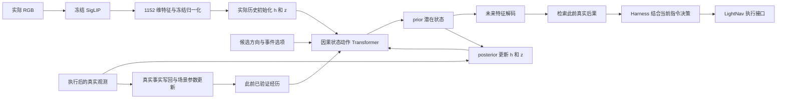

# 事件 TSSM：状态反馈、跨 episode 经历与场景参数更新

日期：2026-11-06。本轮按“继续优化”的授权完成实现、八组训练和真实经历回放。

模型已经具备持续的潜在状态转移、真实观测反馈、分支预测查询、经历写回和场景参数更新接口。
同视角重访中，场景参数更新有明显收益；冷启动未走出口的预测仍未达标。
本轮没有新增模拟器采集，没有加载 LightNav 做导航评测，也没有打开封存场景。

## 本轮改动

旧 `event_latent.py` 是历史 Transformer 加条件潜变量的单目标预测器。
虽然旧实验目录中使用过 `tssm_branch` 名称，但没有“上一状态 → 动作转移 → prior → 真实观测 posterior → 下一转移”的闭环。
本轮新增独立的 `event_tssm.py`，保留旧模型、数据和实验结果，并在历史文档中补充名称更正。

新增实现包含：

1. 确定性状态 `h`、随机状态 `z` 和因果状态/动作序列；真实观测更新 posterior 后参与下一次转移。
2. 不输入未来观测的多步想象，以及同一起点两个出口的配对损失。
3. 跨 episode 保存的真实经历库，以及在真实后果到达后训练的场景适配参数。
4. 接入现有任务 Harness 的显式可选接口，保留当前指令对规划的约束。
5. 发现并修复场景适配向未验证出口传播、导致预测变差的问题。

这是一个最小状态化 TSSM 实现，不是完整复现 Memoir，也没有复现 SC2-WM 的全部设计。

## 模型输入、状态和输出

图中 LightNav 表示系统中的执行位置，本轮只测试了 Harness 接口，没有运行完整导航。

| 项目 | 当前实现 |
|---|---|
| 初始历史 | 8 个实际观测槽位，支持有效位掩码；当前帧必须有效 |
| 视觉特征 | 冻结、已审计 SigLIP 的 1152 维 pooled 特征，沿用历史 fit-only 归一化 |
| 动作条件 | 4 维：方向 sin/cos，以及“途中观测”/“下一事件”选项 |
| 确定性/随机状态 | `h=128`、`z=32` |
| 动力学 | 2 层、4 头因果 Transformer，最多保留 16 个转移 token |
| 全局可训练参数 | 1,531,392，只使用 fit 数据训练 |
| 解码输出 | 与真实记忆同空间的 1152 维单位特征，当前状态加可学习变化，无旧的固定 20° 上限 |
| 多步训练 | 实际观测 posterior 的连续转移；最多三步 prior overshooting |
| 每场景在线参数 | rank-16 解码适配器，59,088 个参数；全局 TSSM、SigLIP、LightNav 在线冻结 |

世界模型预测环境后果，不接受“旧任务应该走哪里”的命令。当前指令、任务进度、主动观测、回溯和出口选择仍由任务 Harness 决定。
场景标识用于数据库和参数文件的命名空间；官方节点编号、相邻点名单、目标坐标、未来真实控制序列均不作为神经预测输入。

“状态更新”和“参数更新”分开实现：posterior 用新画面修正这次 episode 的潜在状态；优化器在真实后果到达后修改该场景的适配器权重。
适配器目前修正输出解码，不代表全局动力学 Transformer 也在在线训练。

## 数据怎样使用

来源仍是已审计的 v4.1 发布包，主事件和终点完全保留。本轮从真实连续执行记录里抽取约 2 米间隔的中间观测，补充状态转移监督。
中间观测只是路径上的实际状态，不被重新标成路口，也不被计为独立新事件。

| 数据 | fit | development |
|---|---:|---:|
| 独立主事件 | 90 | 36 |
| 两次实际执行形成的回放 episode | 180 | 72 |
| 至少有两个连续转移的独立事件 | 21 | 8 |
| 对应含中间观测的回放 episode | 42 | 16 |

总计 252 个回放 episode；最长 20 个观测状态。所需 737 张唯一 RGB 中复用 618 张已编码特征，仅新增编码 119 张中间观测。
fit/development 按房屋隔离；训练梯度只来自 fit。过去经历输入仅来自声明回放顺序中更早、同场景、同分区的实际执行。
两次重复不能算成双倍独立场景；本数据也没有因此变成完整的“连续经过多个真实岔口”的探索数据。

冷启动开发评估只使用 36 条独立主事件、不给历史支持。开发集参与 checkpoint 选择，不能当盲测。
封存场景 `Vvot9Ly1tCj` 未打开。

## 八组离线训练结果

八卡分别运行两个 seed，每个 seed 比较完整模型、去配对损失、去状态反馈、去出口方向。
预先登记最大 1000 次更新；所有实验完成，最佳 checkpoint 均为第 1 次更新，后续训练出现过拟合。
保留 best 和 last，导出固定的 `tssm_pair_seed11/best.pt` 为接口候选，不按看到的结果临时换模型。

| 方法 | seed 11 开发场景宏余弦 | seed 23 开发场景宏余弦 |
|---|---:|---:|
| 复制当前特征 | 0.473385 | 0.473385 |
| 完整 TSSM + 配对损失 | 0.473720 | 0.473662 |
| 去配对损失 | 0.473728 | 0.473663 |
| 去状态反馈 | 0.473780 | 0.473665 |
| 去出口方向 | 0.473822 | 0.473733 |

这些差异不足以支持泛化提升。完整模型 seed 11 的两个出口预测平均夹角只有约 0.012°，而真实后果约 77.67°。
其配对分配分数 56.7% 对应的配对余弦差仅约 `-2.1e-6`，不能据此声称学会区分出口。
继续到第 400 次更新，fit 余弦达到 0.934，开发场景宏余弦下降到 0.358。
因此，本轮验证了架构和训练闭环，但没有验证有效的冷启动分支预测；现有独立样本和多步覆盖仍不足。

## 跨 episode 回放：区分记忆与学习

在 6 个开发房屋上，按声明的 `scene, origin, exit, repeat` 顺序回放 72 次真实执行。
这不是原模拟器墙钟顺序，不跨 episode 拼接运动状态。每次都先保存预测，再揭示真实后果，之后才允许写库和训练场景参数。
开发后果在这里作为到达后可见的在线支持；它与前面的冷启动开发评估分开报告。

每个条件都运行四组：冻结、只记经历、只更新场景参数、经历与参数都用。
下表为最终带适用范围限制的结果，指标是事件特征余弦的样本平均，不是导航成功率。

| 查询类别 | 次数 | 冻结 | 只记经历 | 只更新参数 | 经历 + 参数 |
|---|---:|---:|---:|---:|---:|
| 第一次进入场景 | 6 | 0.495 | 0.495 | 0.495 | 0.495 |
| 已走分支的同视角重访 | 36 | 0.432 | 1.000 | 0.821 | 1.000 |
| 熟悉起点尚未验证的另一出口 | 16 | 0.452 | 0.452 | 0.452 | 0.452 |
| 熟悉场景中的新起点 | 14 | 0.380 | 0.380 | 0.380 | 0.380 |

记忆组接近 1 是已知画面的真实后果查回：强匹配时显式返回 `observed_memory_candidate`，不能计作想象未见后果。
参数组关闭预测时的记忆内容输入，通过场景适配权重预测；已走分支提高到 0.821，说明已发生可持久化的参数学习。
每个在线组均完成 72 次接受的实际更新，权重哈希发生变化，全局模型权重保持不变；数据库、优化器状态和场景参数均通过重启恢复检查。

这里的重复轨迹是同视角、同后果。结果说明对已验证条件的熟悉化有效，尚不能证明跨视角识别同一路口、未知出口推断或跨场景泛化。

第一版未限制适配器适用范围时，已走分支也达到 0.821，但未验证出口从 0.452 降到 0.275，发生负迁移。
该实验保留在 `causal_replay/`。修正后仅在先前实际观察过的输入条件附近应用适配器：当前 source 与已有 source 余弦至少 0.98，方向余弦至少 0.98。
适用性只读取历史输入条件，不读取正确答案。修正版保留在 `causal_replay_scoped/`。
这修复了本批回放中的负迁移，但也明确限制了参数收益的覆盖范围，不能宣称对未走方向有提升。

## Harness 接口与真实性约束

新增 `StatefulTSSMHarness` / `TSSMBranchQueryService`，复用现有任务规划上下文和出口候选结构。
多个出口从同一个实际状态分叉预测；只在执行分支被提交后接受终点反馈。
执行中的真实里程碑更新 posterior；只有实际到达事件并有观测/执行证据，才能写入真实后果并更新参数。
执行偏离时使用实际方向，不把计划分支错误记成已经走过。相同终点画面不会重复计为两次状态转移。

跨 episode 保留 SQLite 事实、场景适配权重、优化器状态和已见样本；开始新 episode 时重置运动潜在状态和转移缓存。
模型预测和相似历史是候选证据，不能自动证明当前出口与某个历史地点连通，也不强制沿旧任务路径行动。
当前默认导航入口未替换；新接口已通过从规划、提交到实际反馈写回的 CPU 集成测试，需要执行器显式提供真实反馈才能启用。
本轮没有重新验收 STOP、任务到达判据、机器人自主节点检测质量或 LightNav 导航成功率。

## 验证与产物

- 88 项相关 CPU 测试通过，覆盖状态反馈、分支隔离、无方向对照、多步想象、写回真实性、跨 episode 持久化、在线更新、适配范围和 Harness 连接；pytest 有既有 `asyncio_mode` 配置警告。
- 所有新增模型/脚本/测试的定向 Ruff 检查通过。没有修改 `src/`。
- 778 个输入绑定哈希和 737 张唯一 RGB 哈希通过检查；126 条主事件历史和终点特征与旧发布包一致。
- 两版回放共 576 次查询通过先预测后揭示、同场景历史截止和事后写回核对；在线组全局权重未改。
- 导出候选的 36 条开发输入 CPU 推理与保存的 GPU 预测最大差为 `2.24e-8`；纯 prior 三步输出形状 `[1,3,1152]`；固定当前画面时，posterior 反馈仍改变下一潜在状态。

主要文件：

- [状态转移实现](/home/szgx/LightNav-0/experiments/world_model/event_tssm.py)
- [持久化和在线更新实现](/home/szgx/LightNav-0/experiments/world_model/tssm_runtime.py)
- [Harness 连接实现](/home/szgx/LightNav-0/experiments/world_model/tssm_queries.py)
- [训练结果](/home/szgx/LightNav-0/output/world_model_training/event_tssm_v2_20261106_01/results.json)
- [修正后因果回放结果](/home/szgx/LightNav-0/output/world_model_training/event_tssm_v2_20261106_01/causal_replay_scoped/results.json)
- [完整性核对](/home/szgx/LightNav-0/output/world_model_training/event_tssm_v2_20261106_01/integrity_audit.json)
- [导出推理检查](/home/szgx/LightNav-0/output/world_model_training/event_tssm_v2_20261106_01/inference_smoke.json)

输入、源码快照、授权、每组 best/last 和预测轨迹都保存在实验目录；旧实验未覆盖。
命令参数和运行接口见 [CONFIGURATION](/home/szgx/LightNav-0/docs/CONFIGURATION.md)。

## 下一轮优先方向

先补能够区分建模问题的监督，再增加参数规模：采同一路口不同来向/朝向、同一出口终点的不同可见画面，以及连续通过 2–3 个真实决策节点的探索链。
这些是与任务最短正确路线无关的环境探索，不要求按目标答案采路。
多次原样重复只能检验记忆和适配，不能替代新的独立分支、多视角和长程动态监督。

模型端需要继续比较当前特征复制、无状态、无方向和确定性模型，检验跨节点 prior 预测和不确定性校准；全局多步能力不能靠同视角重访的查回分数替代。
接口端应先完成带真实节点事件反馈的少量 LightNav 闭环试跑，独立审查任务进度/STOP，再扩大导航评估。
只有未见场景或未验证分支的预测稳定优于基线，才能把世界模型预测作为有实证支持的选路依据。
