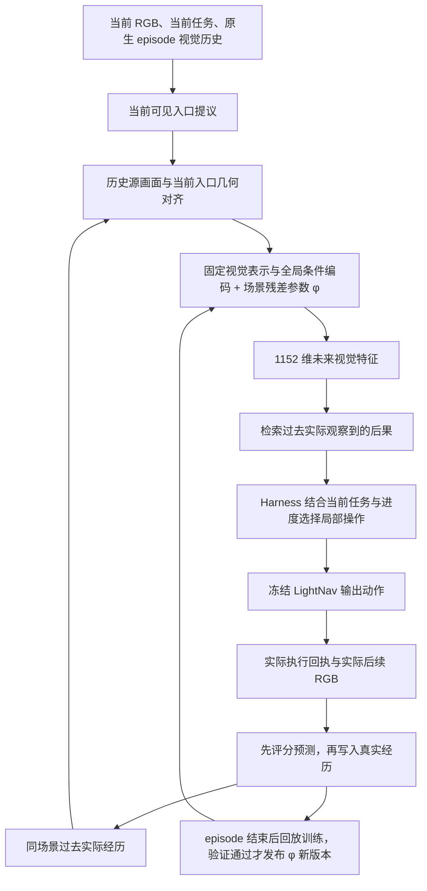

# 跨 episode 场景学习、入口对齐与任务进度：2026-11-05

## 按原始需求复核后的定位

后续逐项复核：见 [事件预测数据与验收审计](world_model_event_readiness_20261105.md)。相同视觉历史的有效分支对照比按地点标签统计更少；严格过去图库的覆盖与原闭集成绩也须分开报告。

用户随后指出：0.6 秒预测不足以说明分支选择能力。原需求和 [事件节点世界模型方案](world_model_event_memory_design_20261103.md) 始终要求：自主发现决策节点，对每个可执行分支预测到下一有意义事件的隐式状态，用预测查询真实经验，按当前任务重新选择；真实经历同时积累环境记忆并改善后续预测。机器人熟悉的是环境，不能只复用旧任务路线。

本轮固定 6 步实验应定位为执行、写回、梯度更新与持久化的工程辅助验证，**不作为主世界模型的有效性验收**。用它替代事件级目标，改变了核心验证问题。下文数值完整保留，但不能据此声称已经学会分支后果或稳定越走越熟。

下一主线优先恢复分支条件的事件级预测，以及同一决策点不同分支真实后果的可区分性评价；进度和 STOP 模块继续作为执行保障，不能替代世界模型主任务的检验。

本轮把真实经历写回、场景参数更新和后续任务加载连接起来，并接入当前入口与历史方向的几何对齐、当前任务的阶段判断。写回与梯度更新是两个独立步骤：前者增加事实记录，后者利用已观测后果优化预测函数。单纯写入 SQLite 不会改变神经网络参数。

这是工程验证与内部开发实验，尚不构成导航收益或新场景泛化的证明。所有在线候选来自当前 RGB；官方节点、真实位置和目标距离不参与规划。仿真位姿、距离与 Success/SPL 只用于实验设置和事后评价。

## 实现和输入输出

- 视觉空间继续使用冻结 SigLIP so400m 的 1152 维 pooled feature，沿用固定标准化契约。它是隐式视觉状态，不是显式物体列表、三维地图或完整物理状态。
- 全局事件模型、视觉 encoder、LightNav 权重保持冻结。本轮实际更新的是每个场景 **40,128 个参数**的低秩 MLP 残差头；没有进行 LightNav 微调或全局世界模型在线全参数训练。
- 残差头输入为当前特征、冻结模型的 128 维条件表示、请求入口的二维方向、预测跨度。输出有界残差，再与基础预测合成为单位化未来特征。即使没有匹配历史，也允许场景参数产生预测。
- 历史只提供“在相似画面下实际发生过什么”的证据。查询结果作为当前任务的类比输入；不会把历史任务指令或旧路线当作本次目标。
- LightNav 保留原生当前 episode 时序历史；切换局部指令不清空该历史，新 episode 正常重置。跨 episode 的真实经历和场景参数独立持久化。

### 两类预测目标严格分开

| 目标类型 | 预测时的时间输入 | 监督来自哪里 | 本轮能验证什么 |
|---|---|---|---|
| `next_event` | 0，表示下一事件耗时未知 | 之前验收的真实事件转移记录 | 按访问顺序重放时，场景更新对后续事件预测的影响 |
| `observed_control_span` | 事先固定为 6 个环境步 | 新实跑实际执行后的 RGB；本配置每步 0.1 秒 | 当前冻结控制策略下约 0.6 秒后的短时视觉预测、写回和再次利用 |

新实跑使用单独的短时预测头与经历库。冻结事件模型仅提供条件表示，未把原“下一节点”输出冒充为固定 6 步预测。固定跨度记录不声称机器人到达了节点、穿过了指定门或完成了局部任务；长跨度节点预测仍需单独验证。

当前 `ControlSpanQueries` 的基础预测是当前特征与已匹配真实历史后果的混合，场景 MLP 再作有界修正；原事件网络的预测输出并未用于这个固定跨度目标，只提供条件表示。因此这批实跑没有验证独立的事件级转移模型。仅把 horizon 改为更大的数，不能自动补齐该能力。

残差还存在结构约束：对单位化基础向量，残差范数严格小于 0.35，最终预测与基础向量的夹角最多约 `asin(0.35)=20.49°`，余弦至少约 0.93675。这是**特征空间角度，不是机器人转角**。本轮 20 条加载适应参数后的目标中，20 条真实目标均位于这个精确可达范围之外；模型仍可改善相似度或检索，但该结构限制它直接表示远离基础预测的未来状态。分支条件转移主干、目标表示和训练损失都需要独立设计与评价。

## 写回、更新、恢复

实现位于 `experiments/world_model/online_scene.py`、`continual_queries.py`、`continual_controller.py`。

1. 提交当前入口局部任务前，保存预测特征、源观察、源步号和参数版本。
2. 收集恰好 6 个连续、同 episode、同局部任务的真实环境执行回执，以及实际源/后续 RGB 文件和 SHA256。局部任务中断或跨度不足的预测不产生训练标签。
3. 实际后果到达后，先计算原版本预测与真实特征的余弦，再写入 `observed_replay.sqlite`。预测画面、未走分支和候选指令不能充当真实后果。
4. 一个 episode 内参数保持固定。结束后按序号保留约 1/4 支持样本作发布验证，其余样本与旧经历混合回放；最多 256 条，每次最多 40 步 AdamW。验证样本不参与梯度。
5. 仅在保留支持样本上的损失改善时发布 `models/v00001.pt` 等新版本；否则恢复原参数与优化器。检查点保存场景参数、优化器、版本及表示/模型/目标类型绑定，SQLite 原子记录活动版本。下个 episode 关闭后重新打开学习器，验证恢复过程。

新实跑绑定还包括控制模型、仿真配置、固定跨度和 waypoint 到速度的转换代码，防止不同时间尺度或控制契约共用同一场景模型。保留支持集很小且会反复用于发布选择，因此发布通过只说明局部回归检查通过，不能替代后续 query 的独立评价。

## 当前入口与历史方向对齐

`entrance_alignment.py` 用实际图像 SIFT 双向匹配与 RANSAC 建立几何对应。在当前 RGB 对齐的有效深度可用时，以 PnP 估计相对相机关系，将当前入口点重投影到历史画面，修正历史分支在当前相机中的方向。深度不足时仅接受有足够二维重投影支持的纯 yaw 旋转；明显平移视差、纹理不足或匹配不足时拒绝。

只有通过对齐的方向进入严格方向门限；不能对齐时不退回原始相机方向。数据库中的原方向保持不变。对齐证明几何支持，不自动证明同一拓扑位置、物理可通行或“这个门必然连接某房间”。

独立真实图像诊断 `entrance_alignment_probe_20261105_01`：40 对近原地转向画面中接受 25 对，接受样本的角误差均小于 5°，中位数 0.0213°；20 对其他场景反例均拒绝。真实位姿只用于选择近原地样本和计算事后误差，没有输入对齐器。这项结果不代表任意平移条件下的准确率。

## 当前任务进度与 STOP

`task_progress.py` 使用独立冻结 Qwen3-VL-4B 拆分当前指令，再从本 episode 的真实图像、阶段起始画面和执行记录判断当前阶段。中间阶段的验证器不接收未来目标，避免用最终目标阻止“离开房间”等阶段推进。

阶段推进需要两次不同实际观察的正面支持，并有执行间隔和图像变化；最终阶段额外要求当前画面可辨识目标及指令要求的停止关系。只有全部阶段获得视觉支持，Harness 才允许整体 STOP。局部 LightNav STOP 先恢复原任务，复用已观察画面重规划，避免重复向原生历史加入同一帧。整体 STOP 缺证据时最多尝试两次观察，再尝试当前入口重规划；无可支持继续动作时明确结束为未验证中止，不冒称成功。

该验证器使用模型自报置信度门限 0.8，尚未校准，重复观察也不构成真实目标判定。严苛的阶段门限可能挡住正确 STOP，错误的视觉判断也可能产生误报，需要单独测量。

### 实跑暴露并修复的问题

- 第一轮试跑的判断错误要求看到第一人称摄像头之外的人体/手部，或在中间阶段检查最终目标，已中止并保留部分产物。
- 第二轮 24 个任务全部卡在第一阶段。检查发现，JSON 模板预填 `completed=false, confidence=0.0` 后，模型会给出“已离开房间”的解释却保留未完成字段。该批结果完整保留，不用于宣称进度模块可用。
- 改为字段类型说明、不预填判定值，要求先写证据再给一致结论。真实保存画面对比及完整组件复查表明：未移动画面不判为完成，离开房间后的画面可以给出完成，目标不可见反例仍不完成。逐帧语义准确率仍未经盲测。

## 已完成的顺序重放结果

`output/world_model_training/online_scene_replay_20261105_02/` 完成 46 场景、658 个转移的四组重放；每个 episode 的全部预测先于该 episode 后果的梯度训练，下一事件真实耗时从未作为预测输入。累计 24,560 步真实优化，发布 368 次场景更新。

内部开发集为 6 场景 44 个转移，此前已检查过，不能称为盲测。下表 R@1 使用仅供离线计分的真实未来特征图库，该图库不在线提供给规划器。

| 方法 | R@1 | 场景宏平均未来特征余弦 |
|---|---:|---:|
| 全冻结，无外部场景记忆 | 27.27% | 0.54559 |
| 只累积真实记忆 | 45.45% | 0.62344 |
| 只更新场景参数 | 29.55% | 0.55249 |
| 记忆与场景参数结合 | 45.45% | 0.62455 |

场景参数能学习，单独适应有小幅改善；在已有记忆之上增加适应，本批 R@1 没有继续提高。新的路线组只有 5 个 query，规模不足以证明跨目标/跨新路线收益。

## 新实跑闭环结果

第二轮 `continual_harness_live_20261105_02/` 为 4 场景 × 3 个任务 × 记忆/记忆加适应两组，共 24 个新实跑；各组起始 RGB 一致，两个场景包含不同路线组。未预灌旧教师轨迹记忆。

该轮累计 2,472 个实际环境步，写入 76 段真实跨度（记忆组 37、适应组 39），执行 400 步优化，发布 9 次参数更新，5 个后续任务加载了非零参数版本。210 个入口查询中，13 次具有对齐后的直接历史支持，38 次使用已学习场景头形成无直接源匹配的预测查询。几何对齐共尝试 143 次，通过 20 次，其中 19 次使用实际当前深度 PnP。

该轮的进度模板缺陷使两个方法的阶段推进和 Success 均为 0；不能把其中部分终点已接近目标解释为完成导航，也不能用它证明在线学习提高了成功率。

修正后的第三轮 `continual_harness_live_20261105_03/` 使用相同 24 个任务重新实跑，完成 2,276 个环境步，写入 **80 段**真实跨度，执行 **440 步**优化，发布 **9 次**参数更新，**7 个后续任务**加载了非零参数版本。

| 方法 | 新任务 | Success | 平均 SPL | 新经历 | 阶段推进次数 |
|---|---:|---:|---:|---:|---:|
| 只累积真实记忆 | 12 | 3/12（25%） | 0.22284 | 41 | 44 |
| 记忆加场景参数更新 | 12 | 4/12（33.33%） | 0.29088 | 39 | 45 |

共 186 个入口查询，21 次具有直接对齐的历史支持，48 次使用无直接源匹配的场景模型预测。148 次几何对齐尝试中通过 26 次，20 次为当前深度 PnP、6 次为纯 yaw。200 轮规划中仅 3 轮提出两个当前入口，180 轮只有一个入口、17 轮没有入口，因此这批实验不足以评价多分支比较和主动探索能力；规划器没有主动选择观察操作，观察动作来自 STOP 后的有界补充观察。

在已经加载适应参数后产生的 **20 个新真实后果**上，用每条记录自己的未适应基础预测作同后果对照：

| 对相同实际后果的预测 | 平均余弦 |
|---|---:|
| 复制当前特征 | 0.67267 |
| 已有真实记忆形成的基础预测 | 0.70457 |
| 基础预测加已发布场景残差 | 0.71139 |

场景残差在这些新后果上的平均增量为 **+0.00681**，并非训练后重算已有目标的成绩。分场景增量分别为 `aayBHfsNo7d -0.00106`、`ac26ZMwG7aT +0.02679`、`ur6pFq6Qu1A +0.01906`、`1LXtFkjw3qL -0.00794`。有两个场景下降，不能称为稳定越走越熟；第二轮相同分析的总体增量也为负，显示小样本和轨迹变化的影响。

STOP 仍不可靠：两组分别实际 STOP 4、5 次，其中各有 1 次超出目标成功范围；另有共 7 个未 STOP 任务的最终距离在 3 米内。这提示阶段漏判/积压，但不能仅凭距离断言全部指令条件都已完成。例如记忆组 `worker_02/episode_00` 将盖布家具判断为已到达晒床脚端，STOP 距离 3.56 米；`worker_03/episode_00` 最终距离 0.23 米，却仍卡在“稍向右”的中间阶段。

3/12 与 4/12 的差异不是稳定导航增益证据：冷启动的成对任务也出现轨迹差异，小样本没有重复种子统计，且部分目标/路线相同。这一轮证明了真实新经历的参数学习和阶段判断实际进入控制，但预测泛化、到达判断和导航收益均未达可靠部署标准。

`verification_review.json` 逐条复核了 80 组保存预测与真实后果、6 步执行回执、同局部任务绑定、原版本预测分数；供规划器消费的 138 次历史图像引用均来自更早 episode。注册输入、冻结源码快照和 LightNav/SigLIP/Qwen 资产的哈希审计通过。实际终点距离与成功指标未反馈给策略。

### 实跑后的组件修正

审计还发现进度模型会把归一化速度当作物理速度，并误读转向符号。当前组件已根据真实控制契约先换算为每步指令前进米数和左正右负的 yaw 角度，再提供给验证器；不再让模型猜测原始 `[-1,1]` 数值的含义。指令量明确标注为已下发控制，不能替代实际相机运动或证明穿过了门。只有已标定、指令转角足够大且图像确实变化的观察动作，才允许缩短第二次确认间隔。

场景头初始化也改为仅设置 CPU 默认生成器，避免 `torch.manual_seed` 同时重置在线推理的 CUDA 随机状态；真实 GPU 检查确认初始化参数哈希保持相同、CUDA RNG 不再改变。

这两项修正完成 CPU 测试和保存真实画面的组件复查；上面的 24 任务数值对应其冻结源码快照，没有把修正后的组件复查冒充为再次完整实跑。

## 验证范围与下一步

相关 **67 项 CPU 测试**及变更 Python 文件 Ruff 检查通过，涵盖写回与训练分离、episode 内冻结、发布/恢复、真实执行证据、未知事件跨度、防止相机方向直接混用、任务阶段顺序、最终目标、控制单位/方向、推理 RNG 隔离和工具格式修复。

扩展运行现有 `tests/world_model`：285 项通过、1 项失败。失败为旧 `test_precollection_checklist_limits_collection_to_authorized_train_fit` 固定要求工作区尚不存在正式采集目录，但当前工作区已有 16 个旧采集目录；本轮未改动这些目录或该断言。这与本轮新增行为测试分开报告。

当前主要限制是主监督跨度偏离事件目标、新鲜真实分支经历少、预测结构偏向基础特征的小幅修正、当前入口感知仍会漏检/误认、阶段判断尚未校准。真实经历的参数更新已经实现，但它不会自动保证机器人每走一次都更准确；事件级未来预测应恢复为主验收目标。

按原始需求重新排序后的验收要求：

1. **主目标改回下一真实事件。** 使用实际穿门、进入新区域、到达下一岔口/转弯后的状态片段；事件时间未知，不将事后耗时作为输入。原验收事件数据继续独立使用；固定 6 步记录保留为短时辅助数据，不能重标为节点到达。2/5/10 秒等固定跨度可作补充诊断，不能替代事件终止。
2. **先验证分支条件预测。** 当前空间/局部入口表示、近期真实状态和可执行技能共同决定未来事件状态，包含不确定性；无匹配历史时仍应能提出预测。对相同当前状态的不同选择采集实际后果，评价正确分支与错误后果的可区分性。语义相同的真实后果允许多正例，不强迫所有不同方向互斥。
3. **评价预测的额外价值。** 在相同输入和历史前缀下，对比复制当前状态、直接真实记忆、仅预测、记忆加预测；分别报告未来事件检索、分支后果区分和实际选路。本轮缺少同条件纯 LightNav 对照，不能宣称整体系统优于基座。
4. **再验证跨目标熟悉化。** 按真实访问顺序记录预测、执行、计分、写回和参数更新。后续 query 使用不同目标/路线，区分已知分支回访、熟悉场景的新分支及新场景冷启动。参数发布后的新后果若持续退步，应回退或降低适应权重；不能只按旧支持集损失决定好坏。
5. **记忆关联与任务判断各司其职。** 对齐负责将历史相机方向关联到当前分支，保持可靠连接与未验证类比的区别；不能对齐不应阻止独立未来预测。阶段积压、目标误识别、主动观察和真实路线回溯在 Harness 层验证，不把机械执行完所有阶段当作世界模型有效的证据。
