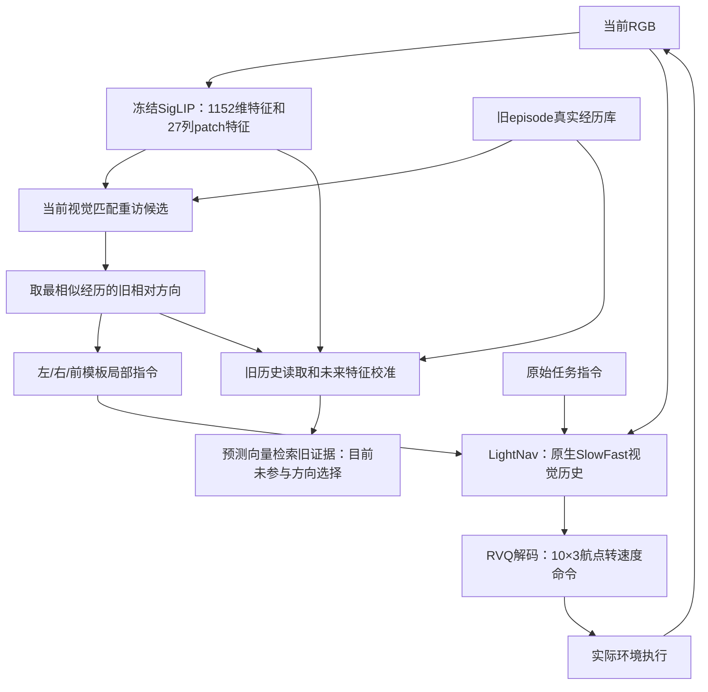

# 当前方案完成度、实际输入输出与优化优先级

日期：2026-11-04（北京时间）。依据当前实现、v1/v2/v3固定对照和真实LightNav/Habitat冒烟。此文是审查与后续设计，不代表下面列出的缺失模块已经实现。

2026-11-05更新：用户明确环境记忆不应决定复用旧路线。已移除live的旧方向自动接管，并加入独立的当前任务决策接口；默认保留当前episode指令。本文下述流程描述11月4日的已留档版本；当前约束与修正见 [world_model_environment_memory_20261105.md](world_model_environment_memory_20261105.md)。

## 总体判断

分层方向可行：Harness组织感知、任务进度、比较与恢复；真实经历持久化；世界模型提供分支后果假设；LightNav负责局部运动。但目前完成的是可复现的实验底座、历史校准与一次执行接入，完整自主决策仍处于早期。

关键澄清：`scripts/smoke_event_lightnav.py` 210–216行先取 `revisits[0].branch_direction`，再把该方向变成局部指令。世界模型返回后只检查 `past_transition_sequences` 是否非空。实时分支不读取 `future_feature` 或 `retrieved_evidence` 来比较方向，也不按原始指令给候选重新评分。

因此，“世界模型→基座接口能调用”不能升级为“世界模型预测已决定选路”。当前实时行为更准确地称为记忆触发的LightNav局部指令原型。部署方向来自旧经历的相对方向；尚未估计并转换当前与历史的朝向差。

## 模块状态

| 模块 | 已有证据 | 完成度边界 |
|---|---|---|
| 数据与可复现实验 | 原始轨迹准入、v4几何弱标注、固定表示、输入/源码绑定、场景分割 | 工程基础较完整；节点语义和出口可见性仍是弱监督 |
| 视觉表示 | 冻结SigLIP pooler和当前图像方向空间特征 | 已实现；不是LightNav自己的视觉编码器 |
| 跨episode真实记忆 | SQLite持久化、因果截止、类型化真实转移、特征契约 | 存取与离线重放完成；实时到达后自动验收/写入没有接通 |
| 未来状态特征 | 约94万参数的v3读取/校准模型，输出1152维连续特征 | 有历史条件下初步有效；无历史返回当前状态，没有有效冷启动预测证据 |
| LightNav执行适配 | 真实权重、10×3航点、局部指令切换、原生历史保留、STOP后恢复 | 接口和受限仿真通过；局部目标遵从性、到达判据未验收 |
| Harness规划 | 有局部目标工具边界和固定恢复规则 | 多候选比较、指令相关性、主动观察、回溯与进度维护未实现 |
| 在线节点/出口 | 从旧经历源画面提出视觉重访候选 | 不等同于陌生场景节点发现或当前可走出口生成 |
| 下游效果 | 44个开发转移、单episode55步冒烟 | 尚无独立导航SR/SPL对照、固定query熟悉化曲线或完整任务成功证据 |

## 已验证收益与解释

v3的同历史直接检索R@1为38.64%，选中校准版本为45.45%，宏平均余弦0.6146→0.6234；44次查询增加3次正确识别，没有减少。新路线子集只有5次，均为20%。这些是离线图库指标，不是导航成功率。

最好的内部验证候选为 `anchored_gate_only_seed20261104`，`residual_scale=0`。它本质上学习如何读历史和融合真实后果：

```text
f_next = normalize((1-g) * f_current + g * sum_i(a_i * f_past_actual_outcome_i))
```

`a_i`和`g`由当前/历史视觉、方向和相似度条件决定。没有历史时g为0，输出当前特征；这个输出应按弃权处理，不能作为陌生分支的有效后果预测。更完整的状态残差版本未优于校准版本，原v1随机TSSM也未建立冷启动分支预测收益。

## 当前实时pipeline

外部输入为RGB、原始指令、调用者提供的场景记忆命名空间、episode身份、以前已经真实完成的经历和控制周期/速度范围。当前实验使用已知MP3D scene选择记忆库；没有自动建筑识别。在线策略不读取官方节点名单、邻接、GT位姿或目标距离。诊断重放的位姿与距离只用于事后评价。



当前实时测试至多触发一次局部目标。预测向量、跨episode特征token和检索原图都没有直接作为LightNav的额外视觉/token输入；基座通过改变任务文字接收局部目标，保持当前episode的原生时序缓冲。

### 预测器输入输出

| 内容 | 单次查询形状/作用 |
|---|---|
| 视觉历史 | `[1,8,1152]` + `[1,8]` mask |
| 当前空间特征 | `[1,27,1152]`，冻结patch网格垂直平均后保留27列 |
| 所选方向 | `[1,2]`，当前相机坐标系sin/cos |
| 最多3条旧经历 | 起始/后果各`[1,3,1152]`，实际方向`[1,3,2]`，有效mask`[1,3]` |
| 未来输出 | `[1,1152]`单位向量、历史支持标记、来源序号和检索证据 |

训练的8个历史token是4个更早事件观察+4个近期观察。当前实时smoke尚无事件状态管理器，前4个token始终补零并mask，只有4个近期观察。这是需要消除的训练/部署差异。

### LightNav与反馈

LightNav接收当前episode连续RGB历史和原始/局部任务文本，用自己的视觉塔和SlowFast采样生成RVQ动作，解码为10行 `[forward_m,left_m,yaw_rad]`。现有策略取首个有效航点，按0.1s控制周期转换成归一化线/角速度，再交给Habitat。

LightNav提出近零轨迹时，执行适配器返回 `stop_proposed`。当前smoke固定拒绝未验收的局部STOP并恢复原任务，没有真正的局部到达或最终任务验收器。

旧接口已经有真实后果写入API，但本次live没有下一事件确认、实际分支确认与自动写入调用，因此长期库在live中仍是只读。失败/截尾结果不能冒充已到达事件。LightNav原生历史采样仍按时间决定，没有实现事件/任务相关采样。

## 优化优先级

1. **让预测真正进入决策。** 从当前观察提出多个可见分支，为每个分支分别预测/检索，结合原始指令、任务进度、来源和不确定性进行比较；允许unknown/补观测。记录预测如何改变所选分支，做去掉/打乱预测的因果对照。不能只是运行网络而不消费它的结果。
2. **完成局部目标执行与终止契约。** 局部目标包含当前可见入口/区域、当前坐标方向、执行范围和到达判据。先独立测试给定正确出口时LightNav能否进入；把“局部完成、最终完成、受阻、需要验证”分别返回。STOP不能永久无条件拒绝。保存原始STOP提议与恢复提议、实时最后画面和事后指标，明确预算结束原因。
3. **把重访和方向变换做实。** 用多帧与地标/估计运动确认重访和朝向差，再把旧方向转换到当前观察；新出口必须来自当前图像。不能把单帧相似度当成位置/朝向真值。Harness负责确认和合并节点，感知工具负责候选。
4. **闭合真实记忆写入与事件历史。** Harness确认真实执行结果后写入新经历，填充4个更早事件token；跨episode保留已确认经历，当前episode短期状态单独reset。被预测的未来不写成事实；受阻/截尾单独记录。先验收只读/可写记忆两种情况。
5. **补有信息量的分支监督。** 同一节点、相近位置与朝向真实走不同出口，增加新视角回访及可靠执行标签；未来目标尝试固定短片段/多视角聚合，减少单帧朝向噪声。已知分支与陌生分支分开评价，再决定是否扩大转移网络或训练多假设。已有614个fit转移只涉及38个多出口起点，继续重复旧样本不能替代反事实分支证据。
6. **改进LightNav历史选择。** 保留近期连续帧，给本回合岔路、门口、指令地标和失败事件分配远期历史预算，并保留绝对顺序。跨episode参考作为独立有来源的记忆输入；若让基座直接读取，需要专门的输入适配与训练/冻结对照。统一视觉token预算后比较，不能用增加上下文解释为采样方法收益。

评测至少区分纯LightNav、相同Harness/执行器的当前视觉直接检索、预测未来检索。新建独立留出场景/路线，按相同访问顺序与动作预算报告SR、SPL、分支到达、正确STOP、额外观察/回溯成本，以及已走/新分支的熟悉化效果。现有开发集不再承担盲测角色。
