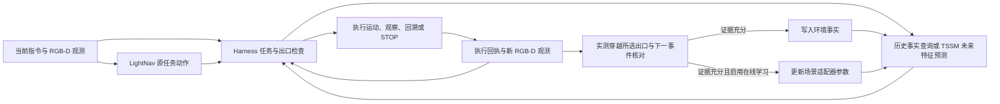

# 任务执行反馈、恢复与 STOP 优化

日期：2026-11-09。本轮改动位于实验 Harness；未修改 LightNav 基座、全局 TSSM
或 SigLIP 权重。评测默认且最多 **500 步**，采集上限仍为 **1000 步**。
这是开发案例的工程验证，不是封存测试或世界模型导航增益评测。

## 这次针对的问题

此前进入终点 3 米范围后仍可能没有成功。一方面，评测距离是到参考终点的
测地距离，不是摄像头到电视等目标表面的距离；另一方面，在线视觉判据、
原始模型 STOP 和局部出口 STOP 曾被混在一起。目标暂时离开视野会过度拦截，
看见目标又可能被误当成已经满足站位要求。

本轮模拟还发现两个独立问题。最终目标没出现，会压低“穿过房间”这个中间
子任务的完成判断；事件模型看到房间变化，也会错误地把结果归给旁边未经过
的出口。后一种错误会污染环境记忆和在线场景参数，必须在写回前拦截。

TSSM 给的是未来状态特征，不是生成的新照片；历史证据使用实际保存的观测。
未经验证的预测默认随行监测，不直接强制改变 LightNav 的原任务动作。
写入一条事实和更新参数是两件事：只有运行时启用 `--online-learning` 才会
使用已验证经历更新场景适配器。当前可更新的是每场景 59,088 个低秩适配器
参数；全局 TSSM、图像编码器和 LightNav 基座不做在线梯度更新。本轮模拟
开启了在线学习；各轮是否有新事实和参数更新，以下面的实际结果为准。

## 实现

1. **任务完成契约。** 分别处理进入房间、停在门口、靠近目标、面对目标及
   进入后面对目标。中间任务只能来自原指令的有序文字片段，禁止补出“房间
   中心”等额外要求。无效拆解退回原指令，但不能仅凭终点画面声称整条
   指令已经验证完成；明确的 `then` 顺序也不能合成一个未经分解的阶段。
2. **分开判断当前阶段与最终目标。** 当前阶段使用独立调用和独立置信度，
   不输入后续目标文字。最终目标仍可在实际经过时独立识别并缓存。同一
   episode 已可靠识别的目标，可以通过实际视觉连续性支持进入其房间后
   的判断；面对目标的任务仍要求当前可见。新 episode 清空目标身份缓存。
   若模型声称当前画面可见目标，但当前候选裁剪未通过独立识别，不能拿先前
   目标身份替这个相互矛盾的当前可见性判断背书。
3. **实际执行反馈。** 每条局部命令带 id、版本、源画面、方向及区域。RGB-D
   特征匹配与 PnP 估计相机实际位移和转向；下发的速度单独记录。图像变化
   或累计下发米数不能冒充实际进展。两次正面支持必须由同一里程计周期内
   的实际位移或转角分开；里程计断开就重新建立确认起点。旧命令回执不能
   写给新命令。0.10 米位移或 15° 转角是视角分离启发式，不是世界模型的
   预测时长、预测距离或机器人到目标的距离。对于“走过、进入”等需要位移
   的阶段，还要求从该阶段内有记录的位置起，实际净位移不少于 0.10 米；
   两次确认之间转头不能单独证明完成了行走。里程计断链时该门槛可能漏掉
   已经发生的位移，且满足门槛仍不能证明整段路线正确。
4. **恢复。** 观察选项会分多步转到请求视角；所有微动作均计入 500 步。
   能估计相机运动时用实测转角校正；估计不可用时退回已发指令估算，不能
   把请求视角当成已经实际看到的视角。
   无效尝试可转为重新观察定位、重新规划，或在当前深度与连续里程计支持
   下返回近期实际经过的局部锚点。恢复完成不会自动跳过必做指令。
   观察预算按进展阶段计算；实际平移或支持充分的任务推进才重置预算。
5. **三态 STOP。** `reached`、有明确反证的 `not_reached` 和 `unknown` 分开。
   看不见电视、看到别的东西或观察到阻挡，本身都不能证明没有到达。声称
   尚未进入目标房间时，必须有独立识别到的目标身份和处于房间外的关系；
   声称目标门口仍在前方时，必须独立识别到门。靠近物体的距离反证来自
   单独的目标深度关系复核。无效小框不会用于估计补观察方向。
   默认 `defer` 在实际补观察后，允许原始全局策略反复提出的 STOP，但标为
   **语义未确认**；它不完成任务阶段，不产生到达事实或训练目标。局部 STOP
   先恢复原任务重新推理。`abstain` 保留严格对照。明确反证禁止不确定性兜底。
   中间任务已经出现第一条视觉支持时，优先用剩余观察预算补第二视角，避免
   过早调用未确认 STOP 打断任务进度。阶段确认推进时立即重置恢复计数，
   让下一阶段有机会获得新视角，而不是沿用上一阶段的 STOP 次数。
   Habitat 还会把线速度、角速度同时低于配置阈值的控制解释为 STOP。现在
   所有未授权的速度命令在发送前先按实际速度范围和配置阈值检查；近零命令
   会被拦截并改为有预算的实际观察，预算耗尽时不发送 STOP。重复观察目标
   也不再返回零角度。日志分别记录隐式 STOP 拦截和环境实际终止原因。
6. **目标框和空间关系复核。** 接受合法的 0–1 和 0–1000 归一化目标框，
   同时拒绝太小、接近整幅画面或无效的框。单独裁剪认不清时，可以给同一
   视觉模型提供有限周边画面，仍要求识别原裁剪中的物体，且不告诉它
   期望类别。对于“旁边”等要求，当前候选框必须具有可用深度；如果框内
   前景与背景深度分布过宽，则不声称有单一目标距离。深度一致也不保证框内
   就是目标，框并不是分割掩码。此值不是参考终点距离，也没有为所有任务
   硬设相同的到达距离。
7. **出口归属检查。** 在源画面估计门框两侧的局部深度平面，并要求内部确有
   更深空间。实际连续 RGB-D 轨迹必须从这个开口内穿过，随后还需两帧新的
   房间/决策事件支持，才能写回。几何缺失、链路中断、未穿越或穿错出口时
   保留轨迹但不写到达事实。源深度文件及哈希随查询保存。
   无法验证的随行假设在新的规划时点刷新，避免旧的远处出口占用整个
   100 步选项期限；有几何支持的假设继续跟踪实际穿越。

默认情况下，未验证的世界模型预测作为随行观察假设，不强制改变 LightNav
按当前指令的选路。可靠历史记忆可支持局部选项；恢复与主动探索有单独入口。
这保留了跨 episode 环境知识与任务路径之间的区别。

## HALO 参考范围

参考的是技能契约、版本化计划、实际执行状态反馈及失败后的插入/重试流程，
对应固定版本 `35d8334e9f7dc3e2b7a7737a9a3ec34f170c809f` 的
[技能登记](https://github.com/apple-aiml-research/ml-halo/blob/35d8334e9f7dc3e2b7a7737a9a3ec34f170c809f/orchestrator/halo_orchestrator/skills.yaml)、
[计划状态](https://github.com/apple-aiml-research/ml-halo/blob/35d8334e9f7dc3e2b7a7737a9a3ec34f170c809f/orchestrator/halo_orchestrator/plan.py) 和
[执行节点](https://github.com/apple-aiml-research/ml-halo/blob/35d8334e9f7dc3e2b7a7737a9a3ec34f170c809f/system/halo_system/nodes/orchestrator_zmq.py)。
没有移植 HALO 模型或机器人代码；没有采用失败后自动跳过必做子任务的行为。
跨 episode 环境事实和场景适配器仍由本项目维护。

## 回归与经验隔离

`task_execution_v2_20261109_01` 是首轮；`_02` 拆开了中间任务检查。
逐帧复核 `_01/doorway` 的写回发现：源第 60 步提出左侧窗户出口，但实际
第 72/78 步机器人朝室内白门走，事件模型仍给出两次高置信度支持。
因此，**前两轮所有经验整体隔离**，根目录均有
`DO_NOT_ADMIT_EXPERIENCE.json`。原始日志保留；其中的写回数量不能当作可靠
的新训练事件或复用经验。

`_03/replayed_attribution_regression` 重放了原来的 113 条动作。在源第 12、60
步逐像素确认 RGB 与原记录完全一致后获取深度，再结合当时实际 RGB-D
位移复核。新检查不采信原来两条写回：一条门框/内部几何不足；窗户一条
没有开放通道的深度支持。这是拒绝错误归属的回归，不能代替正常出口的
召回率评测。

实际历史画面复核共 10 个选择过的开发案例，包括旧电视误识别画面、到达
关系不确定画面、门口正例、中间穿越任务和 4 帧未识别电视却被声称未到达
的画面。最新版本对这 10 个案例均与预设的允许结果一致，结果与调用细节保存在
`_13/completion_calibration`。
另外，`_05/replayed_stop_contradictions` 直接重放 4 条原始模型回答：旧实现
均报明确未到达，修订后均为证据不足。它们是选过的开发回归，检验单次完成
建议，不等于两帧 STOP 验收、盲测准确率或完整概率校准。另有一帧桌边画面
仅作无标签诊断，不计入这 10 个案例的匹配数。

桌边第 80 帧原本识别不到候选物体，还有一处本项目提示词的尺度歧义：只说
“归一化坐标”，解析却假定为 0–1000，而模型给出的是合法的 0–1 坐标。
修正后，该帧局部裁剪加有限上下文可识别出桌子结构，但这不等于已经验证
指令中的特定桌子或站位。按原动作重放 80 步，并逐像素核对 RGB 完全一致后
取回同一帧的实际深度；旧框与重生成框的深度中值分别约 0.65、1.62 米，
两者的第 10–90 百分位深度跨度分别约 1.17、1.53 米，明显混有不同深度。
新门槛将两者都标为混合深度，不把中值当作目标的可靠距离。
该重放没有输入真实目标坐标，也没有写入记忆或更新参数；详细记录见
`_11/actual_depth_ambiguity_audit.json`。

后续从真实轨迹发现另一处更直接的问题：`_10/focus` 第 79 步和 `_10/doorway`
第 98 步，Harness 已拦截 LightNav 的原始 STOP，但补观察恰好生成了物理零
速度；Habitat 把它当作 STOP。两轮返回的官方成功分别发生在离参考终点约
0.414、0.363 米处，但都不是经 Harness 认可的停止，也不是 500 步用尽。
旧版将结束原因笼统写作 `environment_limit`，因此这些成功不能用于证明 STOP
校准有效。旧数据和日志保留，本轮停止了剩余的旧版试验。

`_12/implicit_stop_actual_replay` 原样执行了桌边案例前 79 个已记录动作，并
逐像素核对第 78、79 帧。原来的零速度动作再次使环境以 `agent_stop` 结束并
返回官方成功；修复后的同一控制器入口拦截该动作，发出转头观察，环境继续
运行且画面确实变化。这只是单个回归，不是任务成功率。第 78 帧原先用于
声称桌子距离为 2.31 米的框，实际深度第 10–90 百分位为约 1.10–3.45 米；
新规则拒绝把混合的框中值当成可靠目标距离。用原来记录的两条视觉模型回答
和同一帧真实深度重放，新代码将原先的“明确未到达”改为“未知”；记录在
`_12/mixed_depth_verdict_regression.json`。本次重放没有向控制器提供评测
终点距离，也没有写入经验或训练参数。

`_12/strict` 的电视任务在第 48 帧缓存了电视身份；第 54 帧视觉模型又声称
当前电视可见，但对该候选区域的独立裁剪检查认成了柜子。旧代码仍借第 48 帧
身份把第 54 帧判为“到达”，随后由 Harness 发出 STOP；其官方成功不能作为
可靠的语义确认。保留这两帧及原模型回答重放后，最新代码把第 54 帧改为
“未知”，见 `_13/identity_conflict_regression.json`。这不是说旧电视身份必定
错误，而是当前可见性与当前裁剪证据冲突，不能直接借旧身份消除冲突。

CPU 回归 **165 项通过**，覆盖状态模型/记忆路由、身份跨 episode 隔离、
当前任务阶段独立性、复合目标、实际运动估计、出口平面穿越、旧命令回执、
STOP 分流、零速度隐式 STOP、局部回溯、混合深度拒绝和失效随行假设刷新。
Ruff 对本轮文件检查通过。测试日志和 XML 在 `_13/`。
已隔离经验目录带有本地拒用标记，`PersistentSceneMemory` 在打开数据库前
拒绝加载。实际对旧库的拒绝探测通过，数据库字节未改变。
各运行保存启动时的源码快照；`_03/verification.json` 单独列明启动后的拒用
检查和客户端上限处最终帧检查修正；`_06` 已包含这些修正。`_06` 启动后
又补强了拆解失败和未分解顺序任务的语义完成保护，由针对性 CPU 回归验证；
不得将其算作已在这些启动前的模拟运行里测试过。`_09` 启动后只增加了将
已接受任务阶段及事件的视角和实测运动写入追踪的记录，不改变决策；本轮已
运行任务的这部分依据由输入哈希绑定的 `motion_evidence_audit.json` 重建核对。

全仓门禁也执行过，但**未通过**。`make check` 在未改动的旧文件中报 22 项
静态错误；原始 `make test` 缺少本地 Habitat 包导入路径。补上测试导入路径
后，完整 CPU 测试为 980 通过、63 失败、5 错误、1 跳过：主要是当前环境
缺 pytest-asyncio、沙箱不允许套接字，以及旧预采集测试仍断言不存在正式采集
目录。将本地套接字测试单独在允许套接字的环境中重跑，6 项通过。本轮没有
安装新依赖或修改这些外围文件，完整日志保存在 `_04/`。

## 历史对照：`_09`

`_06` 使用独立空经验库，每个 episode 上限 500 步。`_07` 是新增第二视角
优先规则后的近目标复跑；`_08` 在阶段推进时立即重置恢复计数，再对同一
任务复跑。`_09` 进一步要求视觉支持之间有实测相机运动，并从空经验库复测。
各版源码快照与指标分别保存，审计汇总在 `_09/summary.json`。以下是后续
修复前的历史对照，不能当成当前版本结果。

| 开发任务与策略 | 实际执行步数 | 最近参考终点距离 | 最终参考终点距离 | 停止情况 | 官方成功 | 发 STOP 时视觉确认 |
|---|---:|---:|---:|---|---|---|
| 电视房间，`defer` | 308 | 约 0.716 米 | 约 1.946 米 | 原始 LightNav STOP，未确认兜底 | 是 | 否 |
| 电视房间，`abstain` | 307 | 约 0.716 米 | 约 1.946 米 | 未确认，未发 STOP | 否 | 否 |
| 白门门口，`defer` | 103 | 约 0.458 米 | 约 0.458 米 | Harness 视觉和实测运动支持后发 STOP | 是 | 是 |
| 同场景桌边，`defer` | 86 | 见日志 | 约 0.401 米 | 原始 LightNav STOP，未确认兜底 | 是 | 否 |

电视房间案例在执行第 70 个动作后曾距参考终点约 0.716 米，但 LightNav
之后继续行动，直到步骤索引 297 才第一次提出全局 STOP。两个观察后，默认
策略最终保留该原始 STOP；严格策略在未知状态下不发 STOP。这组对照的前
307 个实际动作完全相同，最终 RGB 图像的哈希也相同；是否提交 STOP
使官方成功标志不同。这不证明系统已经识别出目标电视。
门口案例的最终两次支持画面之间约有 60° 的实测转角。这里的视觉确认是模型
与实际运动提供的支持，不是对所有门口任务的准确率结论。

具体 STOP 来源可在 `steps.json` 中复查。电视任务在索引 297、302 两次由
LightNav 对原任务提出 STOP，Harness 均拦截并转向观察；索引 307 的第三次
STOP，`defer` 放行并标记为未确认，`abstain` 不提交动作。已提交 STOP 后
环境结束，没有继续行走。门口任务在索引 95、98 拦截原模型 STOP 并继续
观察，索引 102 由 Harness 在任务阶段确认后主动提交 STOP。

这些任务均是选取的开发案例，不是盲测。它们没有写入被接受的下一事件，
也没有发生场景适配器参数更新；不能据此评估跨 episode 越走越熟。

`_12/focus` 是零速度 STOP 和混合深度修复后的单任务复跑：机器人越过此前
意外结束的第 79 步，最终第 96 步放行原始 LightNav 的未确认 STOP；离参考
终点约 0.207 米，官方成功，语义仍未确认。第 99 步门口案例由 Harness 在
视觉支持后放行 LightNav STOP，参考终点距离约 0.363 米；门口关系仍主要靠
视觉模型而非独立的门槛几何真值。两例均无被接受事件及场景参数更新。
其中电视任务暴露了上文的当前身份冲突，最新版本继续验证该修复。

## 尚未解决的部分

出口检查偏保守。门框框选不准、纹理不足、深度缺失或长转弯中的里程计丢失，
都会降低可写回事件数量。它保证证据不足时不更新，并不证明几何估计永远
正确。后续应在人工复核的真实出口上测误采信率和漏采信率，改善出口定位和
局部重定位，不能单纯放松门槛以换取更多参数更新。

复看既有样本 `b776287b9f41372068d0a210` 的真实第 5、20、68 帧，发现其
6.8 秒后的房间过渡属于开放布局，没有明确的双侧门框。这说明后续还要给
开放岔口单独定义完成契约。`_04/known_positive_sensor_probe/review.json`
只记录本次画面复核，不是新增采集、人工认证节点或一次算法召回率测试。

电视等物体的目标识别及站位判断仍受小模型和 MP3D 缺失网格影响；语义
未确认 STOP 即使得到官方成功，也不能包装成目标理解或世界模型能力提升。
门口的正向完成仍主要依赖视觉模型判断门框与相机的关系，实测运动只能证明
两个支持视角确实不同，不能单独证明相机恰好在门槛；其目标实例和站位
仍需要更多带人工标注的案例校准。
当前恢复流程、STOP 和记忆写回的工程改善，不代表冷启动未知分支预测已经
达标。仍需更多同节点多出口、跨场景、下一事件级数据验证这种能力。

本轮没有打开封存场景；在线控制不接收参考终点位置、到达距离、成功率或
官方节点邻居表。这些评价量仅留在执行后的评测日志中。
但跨 episode 记忆和场景适配器目前由评测脚本提供的已知场景名分区；该名称
不是神经特征或出口清单。实机要自动找到对应场景的历史，仍需可靠的场景
识别和跨视角重定位，本轮不能证明这一部分已经自主完成。

## 下一阶段验收

1. 为门框通道和开放岔口分别设计完成契约。人工复核同一起点的多个出口，
   包括实际走了所选方向、走了其他方向、被阻挡以及没有走完的记录；分别
   报告错误写回率、漏采信率和证据不足比例。传感器深度与实际运动仍是运行时
   输入，官方图只可用于离线核对，不能充当机器人在线候选清单。
2. 对 STOP 建立覆盖不同目标、遮挡、相同类别不同实例、门口前后和开放房间
   的人工核对集，按场景划分训练/开发，单列假到达和漏到达。比较严格停止、
   观察后原策略停止及任务语义确认，同时单列官方 3 米成功率。应改进目标
   分割，使用能可靠绑定到目标的实际深度；不能将评测终点距离输入控制器。
3. 只把来源出口与实际下一地点都可信的经历写回场景适配器，再做跨 episode
   对照：LightNav 原策略、只用历史记忆、历史记忆加场景参数更新。分别报告
   熟悉分支和未访问分支的未来特征/语义判断与任务导航结果；候选库不应总是
   包含正确答案，并验证无需评测脚本给定场景名时的识别和重定位。路过其他
   方向或受阻的探索仍是有效的实际经历，不要求按
   目标正确路线采集，也不能伪装成已到达下一节点。

主要代码：`skill_contracts.py`、`task_completion.py`、`execution_feedback.py`、
`exit_crossing.py`、`recovery.py`、`stateful_controller.py`；运行入口为
`scripts/run_stateful_harness.py`，参数见 `docs/CONFIGURATION.md`。
